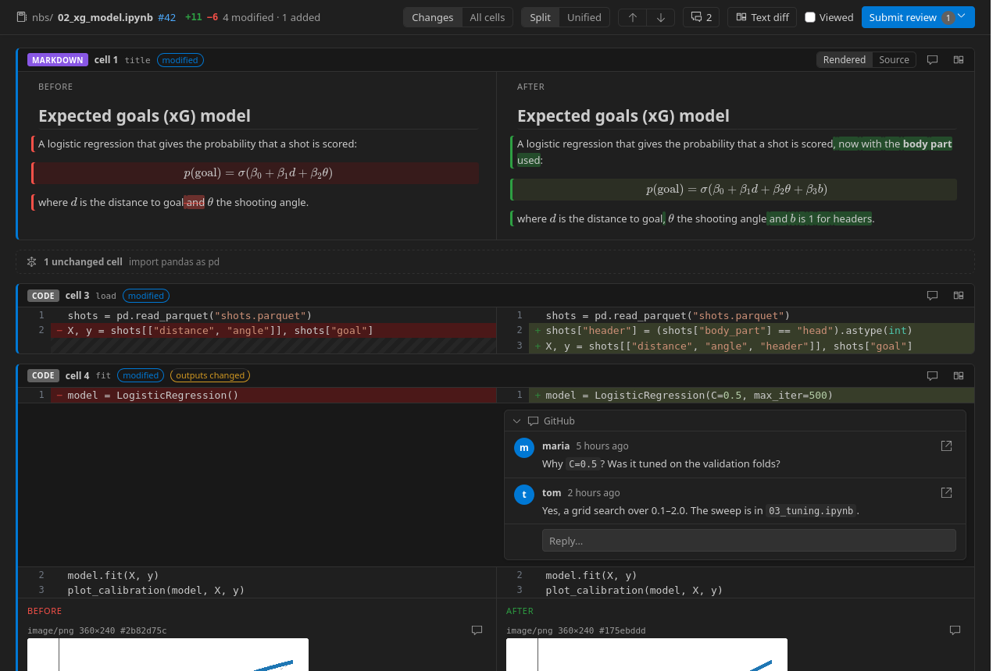
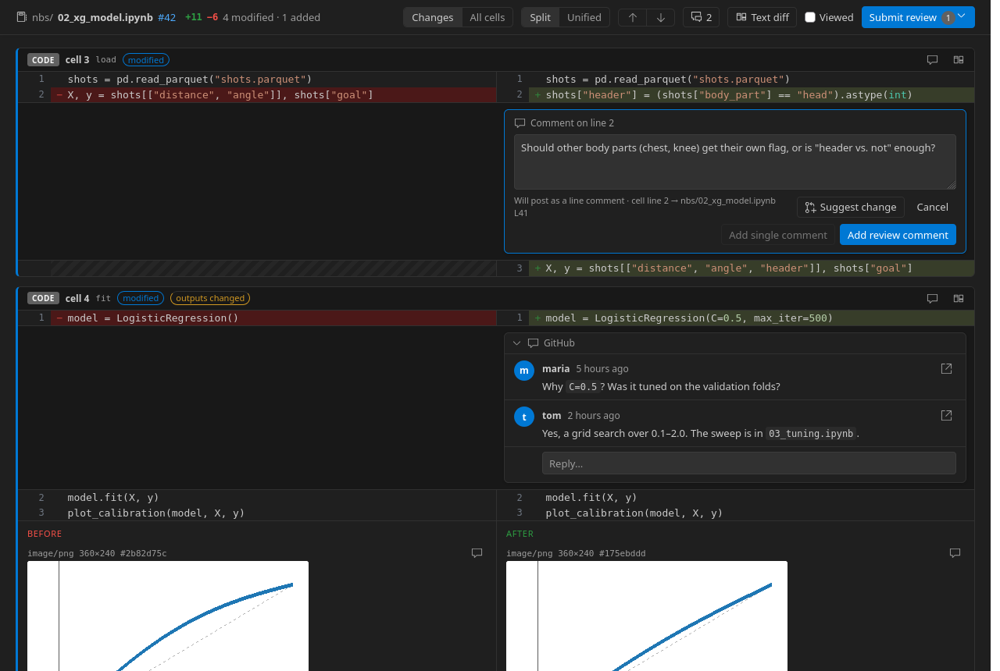
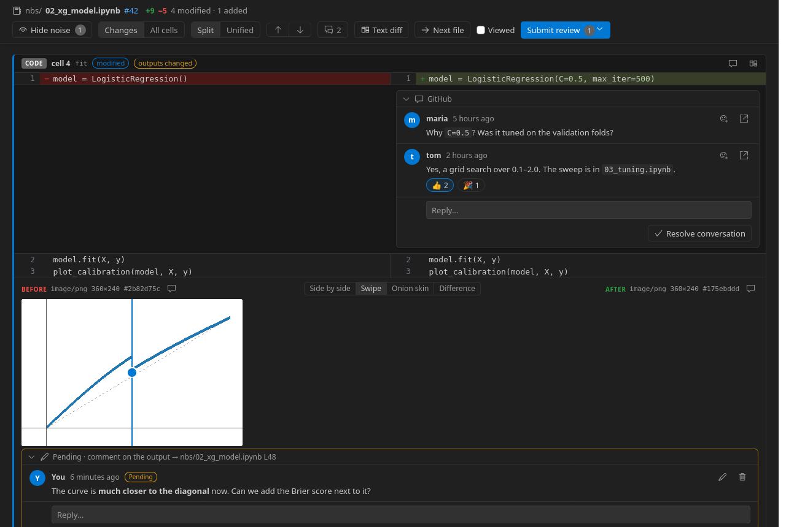
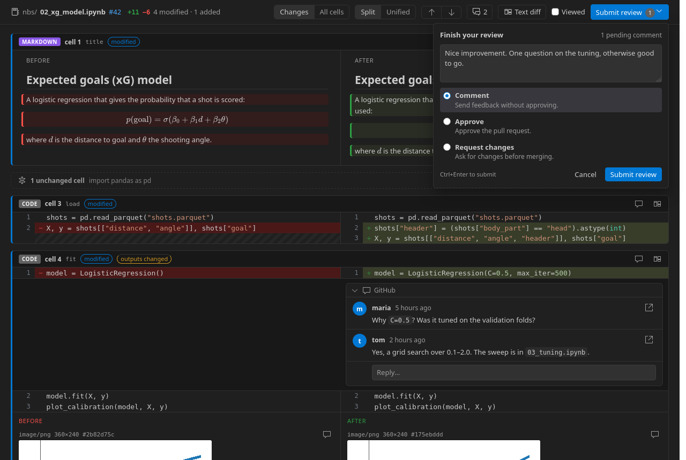

# Notebook Review: Jupyter notebook code review for GitHub pull requests in VS Code

Review the Jupyter notebooks (`.ipynb`) in a GitHub pull request inside VS Code, cell by cell, and leave review comments on code, Markdown and outputs that appear on GitHub as a normal pull request review.



## Why

A Jupyter notebook is a JSON file. On GitHub, and in VS Code's own diff, a notebook pull request shows up as a JSON diff, or as a rendered diff you can't comment on. In practice:

- You can't comment on a Markdown cell, an equation or a plot, only on lines of JSON.
- Teams end up reviewing the generated `.py` files instead of the notebook the change was actually made in.
- Changed outputs (plots, tables, errors) aren't visible at all.
- Hosted review tools need access to your code and their own accounts.

Notebook Review fixes this inside the editor you already use. It reads the pull request from GitHub, shows each notebook as rendered cells, old and new side by side, and posts your comments back to the pull request. Everyone else keeps using GitHub as usual. There's no service in the middle and nothing to install on the repository.

## Features

- **Pull requests to review, at a glance.** The sidebar lists the pull requests waiting for your review, the open pull requests that change notebooks, your own, and the one for the branch you're on, each with the number of notebooks it changes. Click one to start reviewing. No links to copy.
- **Rendered notebook diff.** Markdown is rendered with LaTeX maths, with the changed words marked inside each paragraph, heading, list item and table cell, and added or removed paragraphs shown as a whole. Code is syntax-highlighted with the changed lines marked, and changed outputs (plots, pandas tables, text, errors) are shown before and after. Unchanged cells and unchanged lines fold away, so you only read what changed.
- **Comment on any cell.** Hover a line of code or a Markdown paragraph and click `+`, or drag the `+` over several lines. Every cell and output also has a comment button, so you can comment on a whole cell or on a plot.
- **Comments land on GitHub.** A comment becomes a line comment on the notebook in the pull request when GitHub allows it, otherwise a file comment. Every comment quotes the cell it is about, so it reads well on github.com too.
- **Suggested changes.** "Suggest change" proposes new lines that the author can apply with GitHub's *Commit suggestion* button, directly in the notebook.
- **Reviews saved on GitHub.** "Start a review" adds comments to your pending review on GitHub, the same one github.com uses: private to you until you submit it, kept across restarts and machines, and you can add to it or submit it from VS Code or from github.com. Submit all your comments together as one review: comment, approve or request changes.
- **Single comments, like on GitHub.** "Add single comment" posts a comment or reply straight away. As on github.com, it is available while you have no pending review.
- **Existing review threads.** Comments already on the pull request show on the cell they belong to, with replies, resolved and outdated states.
- **The whole pull request, not just notebooks.** Every other changed file opens in VS Code's diff editor with its own syntax highlighting, the review threads already on it, and the same comment widgets: line comments, single comments, replies, all in the same review.
- **"Viewed" checkboxes and "Next file".** Mark files as viewed, synced with GitHub's own "Viewed" flags, and step to the next file you haven't viewed.
- **Text diff too.** A line-by-line text view of the notebook in VS Code's diff editor, with VS Code's comment widgets, cell headers, outline, sticky scroll and folding. Both views share the same comments.







## Works with any repository with notebooks

Any GitHub pull request that changes `.ipynb` files works: data science and machine learning projects, research code, course material, documentation notebooks.

The rest of the pull request is reviewed in the same place: every other changed file (Python modules, configs, tests) opens in VS Code's diff editor with its syntax highlighting, its existing review threads, and comment widgets that add to the same review. One pull request, one review.

In [nbdev](https://nbdev.fast.ai) repositories, a comment on a generated `.py` module is also shown on the notebook cell the module was exported from (for example comments from an automated reviewer that only looks at `.py` files).

## Install

Install **Notebook Review for GitHub Pull Requests** from the Extensions view, or run:

```bash
code --install-extension KonstantinSofeikov.nbreview
```

To build it from the source:

```bash
npm install
npm run package
code --install-extension nbreview.vsix
```

## Use

1. Open the **Notebook Review** view in the activity bar. **Pull Requests** lists:
   - **This branch**: the pull request of the branch you have checked out;
   - **Waiting for my review**: pull requests where your review is requested;
   - **Changing notebooks**: open pull requests in the repository that change `.ipynb` files;
   - **Created by me**: your own open pull requests.

   The badge on each pull request is the number of notebooks it changes, and its tooltip lists them. Click a pull request to review it. To find one that isn't listed, use the search button (or **Notebook Review: Open Pull Request…**): type to search by title, number, author or branch, or paste a number, `owner/repo#123` or a pull request URL.
2. Click a notebook to open its visual review (the diff icon next to it opens the text diff instead), or any other file to open its diff. Every diff has **Mark as viewed**, **Next file** and **Submit review** buttons in its title bar (the visual review has them in its toolbar), so you can go through the whole pull request file by file. The **Review** panel shows the files grouped into folders; its **View as List** button (next to Collapse All) switches to a flat list, and **View as Tree** switches back.
3. Comment with `+` or the comment buttons, then choose **Start a review** (`Ctrl+Enter`) to add it to your pending review on GitHub, or **Add single comment** to post it now. Pending comments can be edited and deleted; deleting the last one discards the empty review. Replies to existing threads work the same way.
4. Click **Submit review** (in the page, the panel title or the status bar), write an optional summary and choose **Comment**, **Approve** or **Request changes**. **Discard review** (in the same box, or **Notebook Review: Discard Pending Review…**) deletes the pending review and its comments.

Sign-in uses the GitHub CLI (`gh auth login`) when it is installed, otherwise VS Code's built-in GitHub sign-in.

### Keys in the visual review

| Key | Action |
|---|---|
| `n` or `j` | Next change |
| `p` or `k` | Previous change |
| `c` / `Shift+C` | Next / previous comment |
| `Ctrl+Enter` | Add the comment to your review, or submit the review |
| `Esc` | Cancel the comment |

## Settings

| Setting | Default | Description |
|---|---|---|
| `nbreview.defaultView` | `visual` | What opens when you click a notebook: `visual` (rendered cells) or `text` (line-by-line text diff). |
| `nbreview.fileLayout` | `tree` | How the Review panel shows the changed files: `tree` (grouped into folders) or `list` (flat). **Next file** follows the same order. |
| `nbreview.useGhCli` | `true` | Use the GitHub CLI's login when it is available, before asking for VS Code's GitHub sign-in. |
| `nbreview.markGeneratedFilesViewed` | `false` | In nbdev repositories, mark the generated modules viewed together with their notebook. |

## How comments are placed on GitHub

GitHub anchors review comments to lines of the raw `.ipynb` file. Notebook Review keeps track of which JSON line each line of a cell is on:

- If that line is part of the pull request's diff, the comment is a line comment there, so it also shows next to the change in GitHub's "Files changed" tab.
- Otherwise, for example on an unchanged Markdown paragraph, it becomes a file comment on the notebook.
- Each comment starts with a short quote of the cell and has a hidden marker with the cell id. The extension uses it to put the comment back on the right cell after new commits move lines around.

## Development

| Command | Action |
|---|---|
| `npm run build` | Bundle the extension and the review page into `dist/`. |
| `npm test` | Run the unit tests. |
| `npm run typecheck` | Type-check the sources. |
| `npm run package` | Build `nbreview.vsix`. |
| `npm run bench -- [--before REF] [--runs N] TASK ARGS` | Compare the speed of a git ref (default `HEAD`) with the working tree, in alternating fresh processes, and print the mean difference with a 95% bootstrap confidence interval. Tasks: `viewModel BASE.ipynb HEAD.ipynb PATCH …` (building the review page), `activate` (loading the extension), and `openPr owner/repo#123` with `GH_TOKEN` set (opening a pull request; read-only). |
| `npm run demo` | Write `out/demo/index.html`: the review page for the notebooks in `docs/demo/`, outside VS Code. Serve `out/demo` over HTTP to open it. The README screenshots are taken from it. |

The core does not use the VS Code API and is in `src/core/`:

- `notebook.ts`: reads a notebook and records the JSON line of every source line.
- `reviewDoc.ts`: the text form of a notebook used by the text diff.
- `cellDiff.ts`: matches the cells of two versions (by cell id, then by content) and diffs their lines.
- `anchor.ts`: where a comment lands on GitHub, the comment header and marker, suggestions, and the nbdev mapping.
- `patch.ts`: which lines GitHub accepts comments on.

## Limits

- GitHub only: GitLab and Bitbucket are not supported.
- Notebooks whose cells are stored as one string, not a list of lines, are commented on per cell, not per line.
- Images with relative paths in Markdown cells do not show.

## Changelog

### 0.8.1
- The Review panel groups the changed files into folders, like the Explorer, with single-folder chains merged (`src/pkg/models`). **View as List** in its title bar switches to the flat list (setting `nbreview.fileLayout`). **Next file** follows the order shown.

### 0.8.0
- Comments on every file: the diffs of other changed files (Python, configs, tests…) show their review threads and have comment widgets (line comments, single comments, replies) in the same review.
- **Mark as viewed**, **Next file** and **Submit review** buttons in the title bar of every diff, and **Next file** in the visual review's toolbar.
- Generated nbdev modules are listed with the other files; marking a notebook viewed no longer marks its modules unless `nbreview.markGeneratedFilesViewed` is on.
- Fix: links in the review page (the pull request number, links in comments and Markdown) opened twice, in the browser and in VS Code; they now open once, in the browser.

### 0.7.0
- Word-level diff in Markdown cells: the paragraphs, headings, list items and table cells of the two versions are lined up, and only the changed words are marked (red on the old side, green on the new), with bold, links, code and inline maths kept. Added and removed paragraphs are marked as a whole; changed formulas and code blocks are tinted.

### 0.6.1
- The review page uses the full width of the editor instead of stopping at 1600 px, so long lines don't wrap on wide screens.

### 0.6.0
- Pending comments are saved in your pending review on GitHub instead of on this computer. They survive restarts, reinstalls and other machines, stay private to you until you submit, and work together with github.com: comments started there show up here as pending, and either can submit the review.
- Edit, delete and reply to pending comments on GitHub; deleting the last one discards the empty review. **Discard review** deletes a whole pending review.
- "Add single comment" is unavailable while you have a pending review, as on github.com.
- A comment on a cell output stays attached to that output (it used to come back on the cell header), and a comment on several lines keeps its whole range.
- Fix: review tabs show the right pull request number after switching pull requests.

### 0.5.0
- **Add single comment**: post a comment or a reply to GitHub straight away, outside the review, from the review page and from the text diff. It works on lines, cells, outputs and whole files, and doesn't touch a review you have pending on github.com.
- Fix: a review tab that was open when VS Code restarted showed blank until the sidebar was opened.
- Fix: jumping to a change or comment no longer hides it under the toolbar when the toolbar wraps onto two rows.

### 0.4.1
Measured with `npm run bench` against 0.4.0 (mean saving, 95% confidence interval):
- Opening a pull request is about twice as fast: the pull request, its files, review threads and viewed flags are requested at once, and file contents 16 at a time. A pull request with 109 changed files and 14 notebooks opens in 1.6 s, not 3.4 s (saved 1.80 s, CI 1.72–1.88 s).
- The extension loads in half the time: rendering (KaTeX, markdown-it, highlight.js) is loaded when a notebook is first opened. 16.8 ms, not 34.3 ms (CI 17.3–17.6 ms saved).
- The review page is built 30% faster and its data is 35% smaller: unchanged cells are highlighted and sent once, not twice. 34.9 ms, not 50.2 ms, for three notebooks with 230 cells (CI 15.1–15.6 ms saved).
- The package is 481 KB, not 525 KB: the page's 13 icons are built in instead of the whole icon font.
- Fix: unchanged cells you expand show their code instead of a folded placeholder.

### 0.4.0
- A **Pull Requests** list in the sidebar: this branch, waiting for my review, changing notebooks, created by me, with the number of changed notebooks on each.
- **Open Pull Request…** is a searchable list of those pull requests; a number, `owner/repo#123` or URL still works.
- The list refreshes when you switch branches, after you submit a review, and when you come back to VS Code.

### 0.3.0
- One-step review submission: a "Finish your review" box in the review page, and a single picker in VS Code with the summary and Comment, Approve or Request changes.
- Notebook Review is for any repository with notebooks; nbdev support is an extra.
- Icon, MIT license, smaller package (520 KB).

### 0.2.0
- Visual review page: rendered Markdown with LaTeX, highlighted code diffs, outputs before and after, folded unchanged cells and lines.
- Comments on lines, paragraphs, whole cells and outputs, shared with the text diff.
- Editable pending comments.
- GitHub "Viewed" checkboxes.

### 0.1.0
- First version: notebook text diff with comments that post to GitHub, and existing review threads on their cells.

## License

MIT. See [LICENSE](LICENSE).
