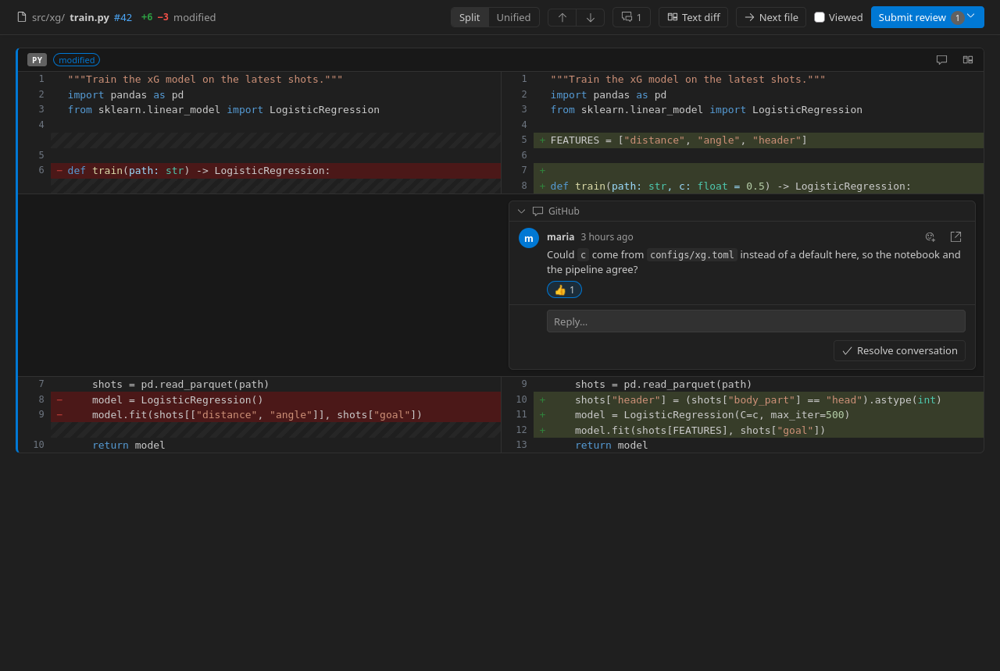

# Notebook Review: Jupyter notebook code review for GitHub pull requests in VS Code

Review the Jupyter notebooks (`.ipynb`) in a GitHub pull request inside VS Code, cell by cell, and leave review comments on code, Markdown and outputs that appear on GitHub as a normal pull request review.

**[Install from the Visual Studio Code Marketplace](https://marketplace.visualstudio.com/items?itemName=KonstantinSofeikov.nbreview)** · [Source on GitHub](https://github.com/sofeikov/nbreview)

Two ways to open a pull request:

- **From the Command Palette, in any window.** Press `Ctrl+Shift+P` (`Cmd+Shift+P` on macOS), run **Notebook Review: Open Pull Request…**, and paste a pull request URL or `owner/repo#123`, or pick one from the list.
- **From your clone of the repository.** Open the repository's folder in VS Code, then the **Notebook Review** view in the activity bar: it lists that repository's pull requests only (yours, the ones waiting for your review, the ones that change notebooks, and the one for your branch). Click one to start reviewing. With no repository open, it lists pull requests from any repository: the ones waiting for your review, the ones involving you that change notebooks, and your own.


## Why

A Jupyter notebook is a JSON file. On GitHub, and in VS Code's own diff, a notebook pull request shows up as a JSON diff, or as a rendered diff you can't comment on. In practice:

- You can't comment on a Markdown cell, an equation or a plot, only on lines of JSON.
- Teams end up reviewing the generated `.py` files instead of the notebook the change was actually made in.
- Changed outputs (plots, tables, errors) aren't visible at all.
- Hosted review tools need access to your code and their own accounts.

Notebook Review fixes this inside the editor you already use. It reads the pull request from GitHub, shows each notebook as rendered cells, old and new side by side, and posts your comments back to the pull request. Everyone else keeps using GitHub as usual. There's no service in the middle and nothing to install on the repository.

## Features

- **Pull requests to review, at a glance.** The sidebar lists the pull requests waiting for your review, the open pull requests that change notebooks, your own, and the one for the branch you're on, each with the number of notebooks it changes. Click one to start reviewing. No links to copy.
- **Rendered notebook diff.** Markdown is rendered with LaTeX maths, with the changed words marked inside each paragraph, heading, list item and table cell, and added or removed paragraphs shown as a whole. Code is syntax-highlighted with the changed lines marked, and changed outputs (plots, pandas tables, text, errors) are shown before and after. Unchanged cells and unchanged lines fold away, so you only read what changed.
- **See where the changes are.** A change map down the right edge of the review page marks removed and added lines and words, changed outputs and comment threads, like the marks in VS Code's scrollbar; click one to go there. A one-line change in a long README or a long notebook is easy to find, and a changed code block in Markdown has its changed lines marked, not the whole block.
- **Compare changed plots.** A plot that changed can be compared side by side, with a **Swipe** divider you drag across, as an **Onion skin** fading from old to new, or as the **Difference**: the changed pixels in magenta with a box around them and the share of the plot that changed. Your choice is remembered, and both plots keep their comment buttons.
- **Hide the noise.** Execution counts and notebook metadata never show as changes. **Hide noise** in the review page also folds away cells whose only change is their outputs (a notebook that was run again) or whitespace (code that was reformatted), and says how many it hid. Counts are of source lines, not the JSON lines GitHub counts, and a notebook that was only run again is marked *outputs only*.
- **Comment on any cell.** Hover a line of code, a Markdown paragraph or a list item and click `+`, or drag the `+` over several lines. Every cell and output also has a comment button, so you can comment on a whole cell or on a plot.
- **Comments land on GitHub.** A comment becomes a line comment on the notebook in the pull request when GitHub allows it, otherwise a file comment. Every comment quotes the cell it is about, so it reads well on github.com too.
- **Suggested changes.** "Suggest change" proposes new lines that the author can apply with GitHub's *Commit suggestion* button, directly in the notebook.
- **Reviews saved on GitHub.** "Start a review" adds comments to your pending review on GitHub, the same one github.com uses: private to you until you submit it, kept across restarts and machines, and you can add to it or submit it from VS Code or from github.com. Submit all your comments together as one review: comment, approve or request changes.
- **Single comments, like on GitHub.** "Add single comment" posts a comment or reply straight away. As on github.com, it is available while you have no pending review.
- **Existing review threads.** Comments already on the pull request show on the cell they belong to, with replies, resolved and outdated states.
- **Resolve conversations.** Resolve a thread when it's dealt with, or unresolve it, from the review page or the text diff, synced with GitHub. The comment counter shows the unresolved threads.
- **Hide comments when they get in the way.** The **Comments** filter shows all conversations, only the unresolved ones, or none, to read a pull request without the discussion in the way. It applies everywhere at once: the review page, the text diff and the comment counts in the Review panel. Your own pending comments always show.
- **Edit, delete and react.** Edit or delete your own comments after they are posted, not only pending ones, and react to any comment with GitHub's 👍 👎 😄 🎉 😕 ❤️ 🚀 👀.
- **Changes since your last review.** When the author pushes after you reviewed, files changed since your review are marked *new*. The review page's **Since your review** switch, or the history button next to a file, shows only what changed since then, not the whole pull request again.
- **The whole pull request, not just notebooks.** Every other changed file (Python modules, configs, tests, the README) opens in the same review page with the same toolbar: highlighted code (Python, YAML, TOML, JSON, SQL, shell, Dockerfile, Makefile, JavaScript, TypeScript, HTML, CSS, R), Markdown rendered with the changed words marked, line and file comments, threads, reactions, **Viewed**, **Next file**, **Since your review** and **Submit review**. **Text diff** opens VS Code's own diff of the file, with the same comments.
- **"Viewed" checkboxes and "Next file".** Mark files as viewed, synced with GitHub's own "Viewed" flags, and step to the next file you haven't viewed. Folders have a checkbox too: tick `tests/` to mark every test as viewed at once, at any depth.
- **Text diff too.** A line-by-line text view of the notebook in VS Code's diff editor, with VS Code's comment widgets, cell headers, outline, sticky scroll and folding. Both views share the same comments.





## Works with any repository with notebooks

Any GitHub pull request that changes `.ipynb` files works: data science and machine learning projects, research code, course material, documentation notebooks.

The rest of the pull request is reviewed in the same place: every other changed file (Python modules, configs, tests) opens in VS Code's diff editor with its syntax highlighting, its existing review threads, and comment widgets that add to the same review. One pull request, one review.

In [nbdev](https://nbdev.fast.ai) repositories, a comment on a generated `.py` module is also shown on the notebook cell the module was exported from (for example comments from an automated reviewer that only looks at `.py` files).

## Install

Install **[Notebook Review for GitHub Pull Requests](https://marketplace.visualstudio.com/items?itemName=KonstantinSofeikov.nbreview)** from the Visual Studio Code Marketplace (search for "Notebook Review" in the Extensions view), or run:

```bash
code --install-extension KonstantinSofeikov.nbreview
```

To build it from the source:

```bash
npm install
npm run package
code --install-extension nbreview.vsix
```

## Use

1. Open the **Notebook Review** view in the activity bar. **Pull Requests** lists:
   - **This branch**: the pull request of the branch you have checked out;
   - **Waiting for my review**: pull requests where your review is requested;
   - **Changing notebooks**: open pull requests in the repository that change `.ipynb` files;
   - **Created by me**: your own open pull requests.

   The badge on each pull request is the number of notebooks it changes, and its tooltip lists them. Click a pull request to review it. To find one that isn't listed, use the search button (or **Notebook Review: Open Pull Request…**): type to search by title, number, author or branch, or paste a number, `owner/repo#123` or a pull request URL.
2. Click any changed file, a notebook or not, to open it in the review page (the diff icon next to it opens VS Code's text diff instead). The page's toolbar has **Viewed**, **Next file** and **Submit review**, so you can go through the whole pull request file by file; in a text diff they are the icons in the title bar. The **Review** panel shows the files grouped into folders; its **View as List** button (next to Collapse All) switches to a flat list, and **View as Tree** switches back. Tick a folder, or **Notebooks** or **Other files**, to mark every file in it as viewed (right-click for **Mark Folder as Viewed** and **Mark Folder as Not Viewed**); in the list layout, run **Notebook Review: Mark Folder as Viewed** from the Command Palette and pick the folder.
3. Comment with `+` or the comment buttons, then choose **Start a review** (`Ctrl+Enter`) to add it to your pending review on GitHub, or **Add single comment** to post it now. Your comments can be edited and deleted, pending or posted; deleting the last pending one discards the empty review. Replies to existing threads work the same way. **Resolve conversation** under a thread marks it resolved on GitHub, and the smiley button adds a reaction. To read without comments, use the funnel button in the review page's toolbar and pick **All comments**, **Unresolved only** or **No comments**. The funnel in the Review panel's title bar and a text diff's title bar does the same: its tooltip says which comments show, and its menu offers the other two choices.
4. Back on a pull request you have reviewed before, files changed since your review are marked *new* in the Review panel. Click the history button next to one, or **Since your review** in the review page, to see only those changes. Comments go on the new side; the old side shows your last review, which is not part of the pull request.
5. Click **Submit review** (in the page, the panel title or the status bar), write an optional summary and choose **Comment**, **Approve** or **Request changes**. **Discard review** (in the same box, or **Notebook Review: Discard Pending Review…**) deletes the pending review and its comments.

Sign-in uses the GitHub CLI (`gh auth login`) when it is installed, otherwise VS Code's built-in GitHub sign-in.

### Keys in the visual review

| Key | Action |
|---|---|
| `n` or `j` | Next change |
| `p` or `k` | Previous change |
| `c` / `Shift+C` | Next / previous comment |
| `Ctrl+Enter` | Add the comment to your review, or submit the review |
| `Esc` | Cancel the comment |

## Settings

| Setting | Default | Description |
|---|---|---|
| `nbreview.defaultView` | `visual` | What opens when you click a changed file, and with **Next file**: `visual` (the review page) or `text` (VS Code's line-by-line text diff). |
| `nbreview.hideNoise` | `false` | Fold cells whose only change is their outputs or whitespace in the review page. The page's **Hide noise** switch changes it and remembers the choice. |
| `nbreview.showComments` | `all` | Which comment threads show by default: `all`, `unresolved` (resolved ones are left out) or `none`. With `none` the Review panel shows no comment counts. Your own pending comments always show. The **Comments** filter changes it and remembers the choice. |
| `nbreview.fileLayout` | `tree` | How the Review panel shows the changed files by default: `tree` (grouped into folders) or `list` (flat). The title bar buttons switch it and remember the choice, as in Source Control. **Next file** follows the order shown. |
| `nbreview.useGhCli` | `true` | Use the GitHub CLI's login when it is available, before asking for VS Code's GitHub sign-in. |
| `nbreview.markGeneratedFilesViewed` | `false` | In nbdev repositories, mark the generated modules viewed together with their notebook. |

## How comments are placed on GitHub

GitHub anchors review comments to lines of the raw `.ipynb` file. Notebook Review keeps track of which JSON line each line of a cell is on:

- If that line is part of the pull request's diff, the comment is a line comment there, so it also shows next to the change in GitHub's "Files changed" tab.
- Otherwise, for example on an unchanged Markdown paragraph, it becomes a file comment on the notebook.
- Each comment starts with a short quote of the cell and has a hidden marker with the cell id. The extension uses it to put the comment back on the right cell after new commits move lines around.

## Development

| Command | Action |
|---|---|
| `npm run build` | Bundle the extension and the review page into `dist/`. |
| `npm test` | Run the unit tests. |
| `npm run typecheck` | Type-check the sources. |
| `npm run package` | Build `nbreview.vsix`. |
| `npm run bench -- [--before REF] [--runs N] TASK ARGS` | Compare the speed of a git ref (default `HEAD`) with the working tree, in alternating fresh processes, and print the mean difference with a 95% bootstrap confidence interval. Tasks: `viewModel BASE.ipynb HEAD.ipynb PATCH …` (building the review page), `activate` (loading the extension), and `openPr owner/repo#123` with `GH_TOKEN` set (opening a pull request; read-only). |
| `npm run smoke -- [--from REV]` | Check the packaged extension in a real VS Code (downloaded into `.vscode-test/`): **A**, a fresh install; **B**, an update in place from the previous release (or `REV`) with **Restart Extensions** and no window reload. In both, every command must be registered and the ones that work without a pull request are run; it fails on any error from them, any Notebook Review error notification or extension host error, and, in A, on any setting that can't be written. Takes about a minute. On Linux, VS Code runs on a virtual display when Xvfb is installed (`sudo apt install xvfb`), so no window opens; `--visible` shows them. |
| `npm run e2e -- --repo owner/name [--keep]` | Check against real GitHub what can't be faked: posted comments edited and deleted, reactions, resolving, and changes since the last review. It opens a draft pull request on a throwaway branch in that repository, and closes it and deletes the branch at the end (`--keep` leaves it open to look at). The comments stay on the closed pull request, so use a repository where that is fine. |
| `npm run demo` | Write `out/demo/index.html`: the review page for the notebooks in `docs/demo/`, outside VS Code. Serve `out/demo` over HTTP to open it. The README screenshots are taken from it. |

Before publishing a release: `npm run typecheck`, `npm test`, `npm run smoke`, then try the new feature by hand in the packaged extension, both freshly installed and updated in place. New commands go in `RUN` or `SKIP` in `scripts/smoke.mjs`; the smoke test fails until they do. Commands must not write settings: right after an update, VS Code hasn't registered the new ones yet.

The core does not use the VS Code API and is in `src/core/`:

- `notebook.ts`: reads a notebook and records the JSON line of every source line.
- `reviewDoc.ts`: the text form of a notebook used by the text diff.
- `cellDiff.ts`: matches the cells of two versions (by cell id, then by content) and diffs their lines.
- `anchor.ts`: where a comment lands on GitHub, the comment header and marker, suggestions, and the nbdev mapping.
- `patch.ts`: which lines GitHub accepts comments on.

## Limits

- GitHub only: GitLab and Bitbucket are not supported.
- Notebooks whose cells are stored as one string, not a list of lines, are commented on per cell, not per line.
- Images with relative paths in Markdown cells and files do not show.
- Binary files and files over 2 MB are not shown in the review page; **Open text diff** shows them in VS Code's diff.

## Changelog

### 0.16.0
- **Hide comments, or only the resolved ones.** A new **Comments** filter shows all conversations, only the unresolved ones, or none. Choose it from the funnel button in the review page's toolbar, the Review panel's title bar or a text diff's title bar, or with **Notebook Review: Show All Comments**, **Show Unresolved Comments Only** and **Hide All Comments**. It applies to every file and view at once and is remembered: hidden threads are left out of the review page and the text diff, and with no comments shown the Review panel drops its 💬 counts. The page's button says how many conversations are hidden. Your own pending comments always show, so a comment you have just written never disappears. It replaces the review page's old "Hide resolved threads" button, which only applied to one page. The new setting `nbreview.showComments` gives the default.
- Fix: after an update with **Restart Extensions**, a review page that was open kept the old version's page, which no longer did anything, and opening the file again made a second tab. Such a page is now replaced by a working one for the same file when it is shown.

### 0.15.0
- **Mark a whole folder as viewed.** Folders in the Review panel, and the **Notebooks** and **Other files** groups, have a Viewed checkbox: tick one to mark every file below it as viewed on GitHub, at any depth, for example all the tests at once. It is ticked when every file below is viewed. Right-click a folder for **Mark Folder as Viewed** or **Mark Folder as Not Viewed**; from the Command Palette the same commands let you pick any folder, which also works in the list layout.
- Marking many files viewed takes a few requests to GitHub instead of one per file. The checkboxes change at once; while GitHub saves them, the Review panel shows its progress bar, and the status bar says how many files are being marked.

### 0.14.1
- Fix: a suggestion on several lines, of which only the last is in the pull request's diff, is now posted as a plain code block. Before, committing it on GitHub replaced only the last line with all the selected lines, so the lines above it appeared twice. The same applies to a cell whose source is stored as one string in the notebook.
- Fix: a suggestion keeps its `$` signs. Before, `$$` (as in LaTeX in a Markdown cell) became `$`.

### 0.14.0
- **Comment on each list item.** In rendered Markdown, every list item (nested items too) and every paragraph in a quote has its own `+`. Before, a list or a quote had one `+` for all of it.
- A comment on rendered Markdown no longer lands on the blank line after a list: it goes on the last line of the item's own text.

### 0.13.2
- Fix: outdated comment threads that are not resolved are no longer folded. Only resolved threads start folded, in the review page and in the text diff. Outdated threads still show the *outdated* label.

### 0.13.1
- README: a link to the Marketplace listing, and the two ways to open a pull request (the Command Palette, or a clone of the repository) at the top.

### 0.13.0
- **Change map**: a strip down the right edge of the review page shows where the removed and added lines and words, changed outputs and comment threads are, with the part of the page in view; a click scrolls there.
- A changed code block in Markdown (a file tree in a README, a list of commands) has its changed lines marked instead of the whole block.

### 0.12.0
- **Every file in the review page**: Python modules, configs, tests and Markdown open in the same page as notebooks, with the same toolbar (Viewed, Next file, Since your review, Hide noise, Submit review), line comments and comments on the whole file, threads, reactions and resolving. Code is highlighted in the usual languages of a data-science repository, and Markdown files are rendered with the changed words marked. **Text diff** still opens VS Code's own diff. `nbreview.defaultView` applies to every file.
- ↑ and ↓ in a file's page step from change to change.

### 0.11.0
- **Compare changed plots**: Side by side, Swipe, Onion skin and Difference views for plots that changed, in the review page. Difference marks the changed pixels and says how much of the plot changed, ignoring faint re-rendering differences.
- Fix: the comment box said "a output comment".

### 0.10.0
- **Hide noise**: a switch in the review page folds away cells whose only change is their outputs (the notebook was run again) or whitespace in their source (the code was reformatted; compared like `git diff -w`, blank lines included), and shows how many there are. Setting `nbreview.hideNoise` gives the default.
- Changed lines are counted in source lines, in the review page and the Review panel, instead of GitHub's count of the notebook's JSON lines, which for a run notebook are mostly outputs and metadata. A notebook that was only run again is marked *outputs only*, one with only metadata changes *metadata only*; GitHub's counts are in the tooltip.

### 0.9.0
- **Resolve and unresolve conversations** from the review page (button under each thread) and the text diff (thread title bar). The comment counter shows unresolved threads, a filter hides resolved ones, and the Review panel's 💬 counts unresolved threads.
- **Edit and delete your posted comments**, not only pending ones. A comment's cell header and marker are kept, and a suggestion in it is encoded again for the notebook.
- **Reactions**: add or take back GitHub's eight reactions on any posted comment, in the review page and the text diff.
- **Changes since your last review**: files changed since you last reviewed (or since you marked them viewed) are marked *new*; the review page's **Since your review** switch and the history button next to a file show only those changes.
- Suggestions made here show as code again when read back or edited, instead of as notebook JSON lines.

### 0.8.2
- `npm run smoke`: a check of the packaged extension, freshly installed and updated in place, run before each release.
- Fix: **View as List** / **View as Tree** failed with "nbreview.fileLayout is not a registered configuration" after updating the extension without reloading the window. The buttons now remember the choice themselves instead of writing the setting, which gives the default.

### 0.8.1
- The Review panel groups the changed files into folders, like the Explorer, with single-folder chains merged (`src/pkg/models`). **View as List** in its title bar switches to the flat list (setting `nbreview.fileLayout`). **Next file** follows the order shown.

### 0.8.0
- Comments on every file: the diffs of other changed files (Python, configs, tests…) show their review threads and have comment widgets (line comments, single comments, replies) in the same review.
- **Mark as viewed**, **Next file** and **Submit review** buttons in the title bar of every diff, and **Next file** in the visual review's toolbar.
- Generated nbdev modules are listed with the other files; marking a notebook viewed no longer marks its modules unless `nbreview.markGeneratedFilesViewed` is on.
- Fix: links in the review page (the pull request number, links in comments and Markdown) opened twice, in the browser and in VS Code; they now open once, in the browser.

### 0.7.0
- Word-level diff in Markdown cells: the paragraphs, headings, list items and table cells of the two versions are lined up, and only the changed words are marked (red on the old side, green on the new), with bold, links, code and inline maths kept. Added and removed paragraphs are marked as a whole; changed formulas and code blocks are tinted.

### 0.6.1
- The review page uses the full width of the editor instead of stopping at 1600 px, so long lines don't wrap on wide screens.

### 0.6.0
- Pending comments are saved in your pending review on GitHub instead of on this computer. They survive restarts, reinstalls and other machines, stay private to you until you submit, and work together with github.com: comments started there show up here as pending, and either can submit the review.
- Edit, delete and reply to pending comments on GitHub; deleting the last one discards the empty review. **Discard review** deletes a whole pending review.
- "Add single comment" is unavailable while you have a pending review, as on github.com.
- A comment on a cell output stays attached to that output (it used to come back on the cell header), and a comment on several lines keeps its whole range.
- Fix: review tabs show the right pull request number after switching pull requests.

### 0.5.0
- **Add single comment**: post a comment or a reply to GitHub straight away, outside the review, from the review page and from the text diff. It works on lines, cells, outputs and whole files, and doesn't touch a review you have pending on github.com.
- Fix: a review tab that was open when VS Code restarted showed blank until the sidebar was opened.
- Fix: jumping to a change or comment no longer hides it under the toolbar when the toolbar wraps onto two rows.

### 0.4.1
Measured with `npm run bench` against 0.4.0 (mean saving, 95% confidence interval):
- Opening a pull request is about twice as fast: the pull request, its files, review threads and viewed flags are requested at once, and file contents 16 at a time. A pull request with 109 changed files and 14 notebooks opens in 1.6 s, not 3.4 s (saved 1.80 s, CI 1.72–1.88 s).
- The extension loads in half the time: rendering (KaTeX, markdown-it, highlight.js) is loaded when a notebook is first opened. 16.8 ms, not 34.3 ms (CI 17.3–17.6 ms saved).
- The review page is built 30% faster and its data is 35% smaller: unchanged cells are highlighted and sent once, not twice. 34.9 ms, not 50.2 ms, for three notebooks with 230 cells (CI 15.1–15.6 ms saved).
- The package is 481 KB, not 525 KB: the page's 13 icons are built in instead of the whole icon font.
- Fix: unchanged cells you expand show their code instead of a folded placeholder.

### 0.4.0
- A **Pull Requests** list in the sidebar: this branch, waiting for my review, changing notebooks, created by me, with the number of changed notebooks on each.
- **Open Pull Request…** is a searchable list of those pull requests; a number, `owner/repo#123` or URL still works.
- The list refreshes when you switch branches, after you submit a review, and when you come back to VS Code.

### 0.3.0
- One-step review submission: a "Finish your review" box in the review page, and a single picker in VS Code with the summary and Comment, Approve or Request changes.
- Notebook Review is for any repository with notebooks; nbdev support is an extra.
- Icon, MIT license, smaller package (520 KB).

### 0.2.0
- Visual review page: rendered Markdown with LaTeX, highlighted code diffs, outputs before and after, folded unchanged cells and lines.
- Comments on lines, paragraphs, whole cells and outputs, shared with the text diff.
- Editable pending comments.
- GitHub "Viewed" checkboxes.

### 0.1.0
- First version: notebook text diff with comments that post to GitHub, and existing review threads on their cells.

## License

MIT. See [LICENSE](LICENSE).
